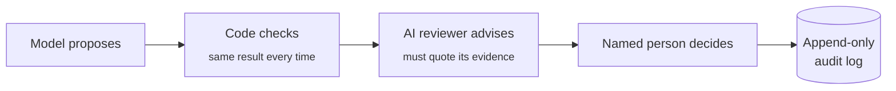

<p align="center">
  <picture>
    <source media="(prefers-color-scheme: dark)" srcset="zyn-identity/logos/dark/512/zyn-wordmark.svg">
    
  </picture>
</p>

<h3 align="center">Traceable work. Checked twice. Decided by a person.</h3>

<p align="center">
  A checker and benchmark for AI-made automotive engineering work:<br>
  requirements, tests and CAN databases, from Zyn or any other tool.
</p>

<p align="center">
  <a href="docs/wiki/Getting-started.md">Getting started</a> ·
  <a href="docs/wiki/How-Zyn-decides.md">How it decides</a> ·
  <a href="docs/wiki/Benchmarks.md">Benchmarks</a> ·
  <a href="docs/wiki/Checks-reference.md">Checks</a> ·
  <a href="docs/wiki/Home.md">Wiki</a>
</p>

<p align="center">
  
  
  
  
</p>

---

## Why Zyn

Engineers don't reject AI tools for being slow. They reject them for being wrong in ways that look right. A public study of 23 practitioner discussions ([research/](research/)) found that:

- **reviewing existing work** is the most requested use (10 of 23)
- **inspecting and correcting AI output** is the most reported cost (14 of 23)
- **plausible false facts** are the second most common reason to reject a tool (9 of 23)

So Zyn doesn't compete on generating more. It checks: deterministic code first, an independent AI reviewer second, a named person last. Every step goes into an append-only log.



## What it catches

Mistakes planted one at a time into clean requirements, tests and CAN databases, then checked by Zyn's code. No model involved, same result every run. [Full results](docs/wiki/Benchmarks.md).

| Planted mistake | Caught |
|---|---|
| A number in a requirement changed (10 becomes 20) | **21 of 22** |
| A timing value added that the source never gives | **150 of 156** (all 156 flagged) |
| "shall" weakened to "should" | **146 of 153** |
| A requirement the source doesn't contain | **8 of 8** |
| A misspelt or out-of-range signal in a test | **68 of 68** |
| A test citing a requirement that doesn't exist, or none | **86 of 86** |
| A test whose checks were deleted, so it can never fail | **40 of 40** |
| A faulty CAN database (10 kinds of fault) | **10 of 10** |
| A signal or status name swapped for another valid one | 1 of 52: needs a person |
| A test's expected on/off value flipped | 0 of 15: needs the fault-kill simulation |

**False alarms on the clean originals: 0 of 156 requirements. 3 of 43 tests were flagged, all for values the test had assumed.**

## Free-written tests or a checked template?

Three Claude models wrote tests freely for the same requirements Zyn's template path covers. Every test ran on the same simulated cluster against the same injected faults. On the seven requirements the simulation models fully (31 faults):

| Path | Faults caught |
|---|---|
| **Template path (Anvil)** | **30 of 31** |
| Sonnet, two runs | 25 and 26 |
| Opus, two runs | 25 and 23 |
| Haiku, two runs | 22 and 21; in each run, every test for at least one requirement failed to run |

More tests did not mean more coverage, and the same model asked twice wrote a different test set. [Method and full results](docs/wiki/Benchmarks.md#s2-free-written-tests-or-a-checked-template).

## The tools

| | Tool | What it does |
|---|---|---|
| <picture><source media="(prefers-color-scheme: dark)" srcset="zyn-identity/logos/dark/32/sift-mark.svg"></picture> | [**Sift**](docs/wiki/Sift.md) | Requirements from a specification, each with the source words it came from |
| | [**Sift Review**](docs/wiki/Sift-Review.md) | Checks an existing requirement set (ReqIF, Excel, CSV) against its source |
| | [**Sift Delta**](docs/wiki/Sift-Delta.md) | What changed between revisions, and which approved requirements it affects |
| <picture><source media="(prefers-color-scheme: dark)" srcset="zyn-identity/logos/dark/32/anvil-mark.svg"></picture> | [**Anvil**](docs/wiki/Anvil.md) | Test cases built by code from checked templates, scored against injected faults |
| | [**Anvil Review**](docs/wiki/Anvil-Review.md) | Checks tests from any tool against a CAN database and requirements |
| <picture><source media="(prefers-color-scheme: dark)" srcset="zyn-identity/logos/dark/32/assay-mark.svg"></picture> | [**Assay**](docs/wiki/Assay.md) | Benchmarks: accuracy, repeatability and cost per model on public answer keys |
| <picture><source media="(prefers-color-scheme: dark)" srcset="zyn-identity/logos/dark/32/scribe-mark.svg"></picture> | Scribe, Source | Planned: documents, and procurement |

## What makes it different

- **Quotes verified by code.** Every AI finding must quote words that code confirms are there.
- **No confidence scores.** Cards show checks that passed or failed, not a model's opinion of itself.
- **No silent pass.** Empty or junk input is refused or reported as skipped, never passed.
- **Decisions persist.** A dismissal carries over to later runs of the same text.
- **Works on anyone's output.** The same checks run on requirements and tests from other tools, and as an MCP server inside an agent's loop.
- **Fits existing tools.** ReqIF round-trip to DOORS Next, Polarion and Codebeamer; pytest, Robot Framework and CAPL exports.
- **Runs offline.** One setting refuses every cloud call; local models run through Ollama.

## Quick start

Windows, PowerShell, inside the project folder. [Full guide](docs/wiki/Getting-started.md).

```powershell
py -3.11 -m venv .venv
.\.venv\Scripts\python -m pip install -r requirements.lock
.\.venv\Scripts\python -m pip install -e ".[dev]"
Copy-Item .env.example .env; notepad .env     # paste ANTHROPIC_API_KEY
.\.venv\Scripts\python -m harness smoke       # two model calls, well under USD 0.50
.\review.ps1                                  # opens the review screen
```

No key? The checkers run on code alone:

```powershell
.\.venv\Scripts\python -m harness testcheck tests.py --dbc data\synthetic\icx100.dbc --reqs data\synthetic\icx100_reqset.csv
```

## Documentation

| | |
|---|---|
| [Wiki home](docs/wiki/Home.md) | Start here |
| [How Zyn decides](docs/wiki/How-Zyn-decides.md) | The trust model, verdicts and audit log |
| [Benchmarks](docs/wiki/Benchmarks.md) | Every result, with its method and limits |
| [Checks reference](docs/wiki/Checks-reference.md) | Every check, what it catches and where it stops |
| [Research basis](docs/wiki/Research-basis.md) | What engineers asked for, and how Zyn answers it |
| [Architecture](docs/wiki/Architecture.md) · [Integrations](docs/wiki/Integrations.md) | How it fits together, and around your tools |
| [Data and licences](docs/wiki/Data-and-licences.md) | Every dataset and its licence |
| [Development](docs/wiki/Development.md) · [Roadmap](docs/wiki/Roadmap.md) | For contributors |

## Honest limits

- **Prototype.** Every screen and export says so. Nothing is verified until a named person approves it.
- **Public and synthetic data only.** No company or customer documents.
- **The ICX-100 answer key** was written by Claude and checked by an AI reviewer, not an engineer. Every score on it says so.
- **No productivity claims.** Zyn reports what it measured, on named datasets, with the method beside the number.
- **Not a qualified tool** under ISO 26262. [A draft tool confidence argument](docs/06-tool-confidence.md) exists; a safety engineer has not reviewed it.

## Repository

```
harness/        Python: model runner, checks, audit store, API, MCP server
  sift/           requirements: extraction, review, delta, ReqIF
  anvil/          tests: templates, generation, fault simulation, DBC checks
web/            React review screen on the Zyn design system
evals/          public evaluations and showcase benchmarks
data/synthetic/ the ICX-100 example: spec, revision, requirements, DBC, answer key
docs/           direction, evaluations, benchmark reports, wiki
research/       the practitioner study and the public data survey
zyn-identity/   marks, icons, wordmarks and their build tools
rules/          rule profiles for Sift Review
tests/          pytest suite, offline, no key needed
```
