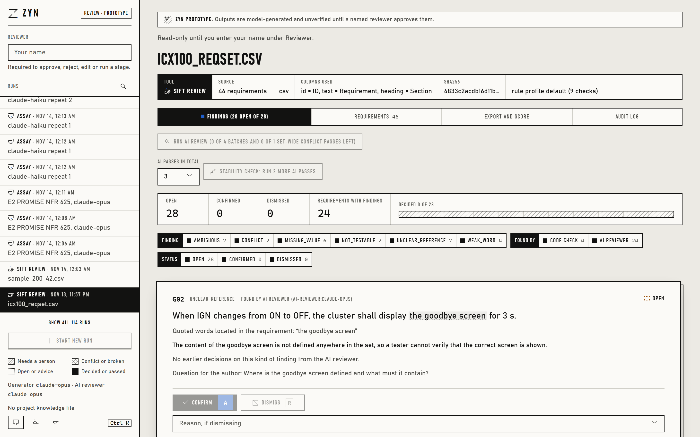
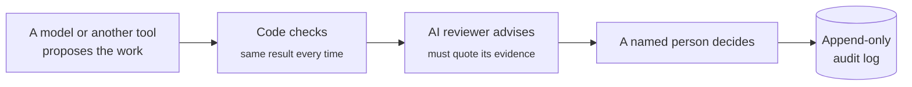

<p align="center">
  <picture>
    <source media="(prefers-color-scheme: dark)" srcset="zyn-identity/logos/dark/512/zyn-wordmark.svg">
    
  </picture>
</p>

<h1 align="center">AI writes the work. Zyn proves which parts you can trust.</h1>

<p align="center">
  The checker for AI-made automotive engineering work.<br>
  Requirements, tests and CAN databases, from Zyn or from any other tool,<br>
  checked by code, reviewed by a second AI, decided by a named person.
</p>

<p align="center">
  <a href="#quick-start"><b>Quick start</b></a> ·
  <a href="#the-proof"><b>The proof</b></a> ·
  <a href="#the-tools"><b>The tools</b></a> ·
  <a href="docs/wiki/Benchmarks.md"><b>Benchmarks</b></a> ·
  <a href="docs/wiki/Home.md"><b>Wiki</b></a>
</p>

<p align="center">
  
  
  
  
  
  
</p>

<p align="center">
  <picture>
    <source media="(prefers-color-scheme: dark)" srcset="docs/img/review-dark.png">
    
  </picture>
</p>

<p align="center"><sub>The review screen. Every finding shows the words it rests on, who raised it (code check or AI reviewer), and waits for a person.</sub></p>

---

## The problem Zyn solves

AI can now write a requirement set or a test suite in minutes. Checking it still takes days, and that is where teams give up.

A public study of 23 practitioner discussions ([research/](research/)) says it plainly:

| What engineers said | How often |
|---|---|
| Inspecting and correcting AI output is the biggest cost | **14 of 23** |
| Reviewing existing work is the use they want most | **10 of 23** |
| Plausible false facts are a reason to reject the tool | **9 of 23** |

Engineers don't reject AI tools for being slow. They reject them for being wrong in ways that look right.

**So Zyn doesn't try to generate more. It makes the output checkable.**

## What you get

<table>
<tr>
<td width="33%" valign="top">

### Mistakes caught by code

Changed numbers, invented values, weakened wording, misspelt signals, tests that can never fail. Found by deterministic checks: same input, same result, every run. No model, no key, no cost.

</td>
<td width="33%" valign="top">

### Evidence you can read

No confidence scores. Every AI finding must quote the words it rests on, and code confirms those words are really there before you ever see it.

</td>
<td width="33%" valign="top">

### A record that holds up

Nothing is approved until a named person approves it. Every proposal, check and decision lands in an append-only audit log you can export.

</td>
</tr>
</table>

## How it works



Three layers, in order of trust. Code decides what it can prove. The AI reviewer only advises, and only with quotes. A person makes every final call, and the log remembers who and when.

Read more: [How Zyn decides](docs/wiki/How-Zyn-decides.md).

## The proof

We planted mistakes one at a time into clean requirements, tests and CAN databases, then let Zyn's code checks look for them. No model involved.

| Planted mistake | Caught |
|---|---|
| A number in a requirement changed (10 becomes 20) | **21 of 22** |
| A timing value added that the source never gives | **150 of 156** (all 156 flagged) |
| "shall" weakened to "should" | **146 of 153** |
| A requirement the source doesn't contain | **8 of 8** |
| A misspelt or out-of-range signal in a test | **68 of 68** |
| A test citing a requirement that doesn't exist, or none | **86 of 86** |
| A test whose checks were deleted, so it can never fail | **40 of 40** |
| A faulty CAN database (10 kinds of fault) | **10 of 10** |

**False alarms on the clean originals: 0 of 156 requirements. 3 of 43 tests, all for values the test had assumed.**

And where code alone is not enough, Zyn says so:

| Planted mistake | Caught by code | What catches it instead |
|---|---|---|
| A signal or status name swapped for another valid one | 1 of 52 | A person |
| A test's expected on/off value flipped | 0 of 15 | The fault-kill simulation in Anvil |

### Templates beat free-written tests

Three Claude models wrote tests freely for the same requirements Zyn's template path covers. Every test ran on the same simulated instrument cluster, against the same injected faults (31 faults across the seven requirements the simulation models fully).

| Path | Faults caught |
|---|---|
| **Zyn template path (Anvil)** | **30 of 31** |
| Sonnet, two runs | 25 and 26 |
| Opus, two runs | 25 and 23 |
| Haiku, two runs | 22 and 21 |

More tests did not mean more coverage. The same model asked twice wrote a different test set. The largest model was no better than the middle one.

<details>
<summary><b>More results: model cost, real-world files, review workload</b></summary>

<br>

**Which model, at what cost?** Each task run three times per model.

| Task | Opus | Sonnet | Haiku |
|---|---|---|---|
| Requirement review on ICX-100 (recall) | 0.608 | 0.647 | 0.49 |
| Requirement type on PROMISE (accuracy, human labels) | 0.914 | 0.886 | 0.881 |
| Extraction from whole RTEMS components (F1) | 0.994 | 0.988 | 0.985 |
| Cost per correct item, QuRE defect flags (USD) | 0.01744 | 0.00691 | 0.00044 |

The biggest model did not buy better review. The cheapest was in the same score band on narrow tasks at about one fortieth of the cost.

**Does it hold up on real files?** Zyn's DBC checks on the 58 CAN databases of comma.ai's opendbc.

| Result | Count |
|---|---|
| Files read and checked | 50 of 58 (22,909 signals) |
| Files refused, each with the reason | 8 |
| Signals whose limits their bits cannot carry | 545 |
| Messages with signals sharing bits | 191 |

**How much review work do the flags create?** On QuRE (200 automotive requirements, human-labelled), the AI reviewer found 63 of 72 real defects. More than half of its flags were words people judged acceptable. That is why dismissing is one key, and a dismissal carries over to unchanged text.

</details>

Every number has its dataset, method and limits beside it: [Benchmarks](docs/wiki/Benchmarks.md). The raw results are one JSON file: [showcase.json](docs/bench/showcase/showcase.json).

## The tools

| | Tool | What it does for you |
|---|---|---|
| <picture><source media="(prefers-color-scheme: dark)" srcset="zyn-identity/logos/dark/32/sift-mark.svg"></picture> | [**Sift**](docs/wiki/Sift.md) | Turns a specification into requirements, each tied to the source words it came from |
| | [**Sift Review**](docs/wiki/Sift-Review.md) | Reviews a requirement set you already have (ReqIF, Excel, CSV) against its source |
| | [**Sift Delta**](docs/wiki/Sift-Delta.md) | Shows what changed between two revisions, and which approved requirements it touches |
| <picture><source media="(prefers-color-scheme: dark)" srcset="zyn-identity/logos/dark/32/anvil-mark.svg"></picture> | [**Anvil**](docs/wiki/Anvil.md) | Builds test cases by code from checked templates, then scores them against injected faults |
| | [**Anvil Review**](docs/wiki/Anvil-Review.md) | Checks tests from any tool against a CAN database and the requirements they claim to cover |
| <picture><source media="(prefers-color-scheme: dark)" srcset="zyn-identity/logos/dark/32/assay-mark.svg"></picture> | [**Assay**](docs/wiki/Assay.md) | Benchmarks any model on public answer keys: accuracy, repeatability and cost per correct answer |
| <picture><source media="(prefers-color-scheme: dark)" srcset="zyn-identity/logos/dark/32/scribe-mark.svg"></picture> | Scribe, Source | Planned: documents, and procurement |

## Why Zyn

| | |
|---|---|
| **Works on anyone's output** | Point it at requirements and tests from any tool or any person. You don't have to generate with Zyn to check with Zyn. |
| **Quotes verified by code** | An AI finding without a quote that code can locate is never shown. |
| **No confidence scores** | Cards show which checks passed or failed, not a model's opinion of itself. |
| **No silent pass** | Empty or junk input is refused or reported as skipped. It is never passed. |
| **Decisions persist** | Dismiss a finding once. It stays dismissed on later runs of the same text. |
| **Fits your toolchain** | ReqIF round-trip to DOORS Next, Polarion and Codebeamer. Exports to pytest, Robot Framework and CAPL. |
| **Runs inside an agent** | The same checks are an MCP server, so an AI agent can check its own work before it hands it over. |
| **Runs offline** | One setting refuses every cloud call. Local models run through Ollama. |
| **Assessor-ready exports** | An evidence report and an ISO/IEC 33020 style checklist (fully, largely, partially, not achieved) in Excel. |

## Use it when

- **A supplier or a colleague hands you AI-written requirements** and you need to know what was changed, invented or weakened before you sign.
- **You have a test suite from an AI assistant** and want to know which tests name signals that don't exist, or can never fail.
- **A specification got a new revision** and you need the list of approved requirements it affects.
- **You inherited a CAN database** and want its overlaps, impossible ranges and undeclared nodes listed before you build on it.
- **You are choosing a model** and want accuracy, repeatability and cost per correct answer on public data instead of a vendor's slide.

## Quick start

Windows, PowerShell, inside the project folder. Full guide: [Getting started](docs/wiki/Getting-started.md).

```powershell
py -3.11 -m venv .venv
.\.venv\Scripts\python -m pip install -r requirements.lock
.\.venv\Scripts\python -m pip install -e ".[dev]"
Copy-Item .env.example .env; notepad .env     # paste ANTHROPIC_API_KEY
.\.venv\Scripts\python -m harness smoke       # two model calls, well under USD 0.50
.\review.ps1                                  # opens the review screen
```

**No key? No problem.** The checkers run on code alone:

```powershell
.\.venv\Scripts\python -m harness testcheck tests.py --dbc data\synthetic\icx100.dbc --reqs data\synthetic\icx100_reqset.csv
```

The repository ships with ICX-100, a complete synthetic instrument cluster example (specification, revision, requirement set, CAN database, answer key), so you can try every tool in minutes without your own data.

## Fits around your tools

| You use | Zyn gives you |
|---|---|
| DOORS Next, Polarion, Codebeamer | ReqIF in and out, with review state and findings as attributes |
| pytest, Robot Framework, CANoe | Test exports in each format, plus a flat step table for tools that import tabular steps |
| An AI coding agent | An MCP server: the agent calls Zyn's checks inside its own loop |
| CI and assessors | An evidence report and a checklist workbook per run |

Details: [Integrations](docs/wiki/Integrations.md).

## Questions people ask

<details>
<summary><b>Do I have to generate with Zyn to use it?</b></summary>
<br>
No. Sift Review and Anvil Review check work from any tool or person. That is the main use.
</details>

<details>
<summary><b>Does my data leave my machine?</b></summary>
<br>
Only if you let it. The code checks never call a model. Set offline mode and every cloud call is refused; local models run through Ollama.
</details>

<details>
<summary><b>Why no confidence score?</b></summary>
<br>
A model's rating of itself has not been shown to predict correctness. Zyn shows checks that passed or failed, and quotes you can read.
</details>

<details>
<summary><b>The AI reviewer gives different answers each run. How is that handled?</b></summary>
<br>
Zyn measures it instead of hiding it. You can run several passes and see how many reported each finding, and your decisions carry over between runs.
</details>

<details>
<summary><b>Will it save my team time?</b></summary>
<br>
We don't claim a number. No benchmark here measures time saved; that needs a pilot with real engineers on real work. What Zyn does measure is what it catches and what it misses.
</details>

More: [FAQ](docs/wiki/FAQ.md).

## Documentation

| | |
|---|---|
| [**Getting started**](docs/wiki/Getting-started.md) | Install, first run, first review |
| [**How Zyn decides**](docs/wiki/How-Zyn-decides.md) | The trust model, verdicts and audit log |
| [**Benchmarks**](docs/wiki/Benchmarks.md) | Every result, with its method and limits |
| [**Checks reference**](docs/wiki/Checks-reference.md) | Every check, what it catches and where it stops |
| [**Research basis**](docs/wiki/Research-basis.md) | What engineers asked for, and how Zyn answers it |
| [**Architecture**](docs/wiki/Architecture.md) · [**Integrations**](docs/wiki/Integrations.md) | How it fits together, and around your tools |
| [**Data and licences**](docs/wiki/Data-and-licences.md) | Every dataset and its licence |
| [**Development**](docs/wiki/Development.md) · [**Roadmap**](docs/wiki/Roadmap.md) | For contributors, and what comes next |

## Honest limits

A checker that oversells itself is worthless, so here is where Zyn stops.

- **Prototype.** Every screen and export says so. Nothing is verified until a named person approves it.
- **Public and synthetic data only.** No company or customer documents were used.
- **The ICX-100 answer key** was written by Claude and checked by an AI reviewer, not an engineer. Every score on it says so.
- **No productivity claims.** Zyn reports what it measured, on named datasets, with the method beside the number.
- **Not a qualified tool** under ISO 26262. A [draft tool confidence argument](docs/06-tool-confidence.md) exists; a safety engineer has not reviewed it.

## Repository

```
harness/        Python: model runner, checks, audit store, API, MCP server
  sift/           requirements: extraction, review, delta, ReqIF
  anvil/          tests: templates, generation, fault simulation, DBC checks
web/            React review screen on the Zyn design system
evals/          public evaluations and showcase benchmarks
data/synthetic/ the ICX-100 example: spec, revision, requirements, DBC, answer key
docs/           direction, evaluations, benchmark reports, wiki
research/       the practitioner study and the public data survey
zyn-identity/   marks, icons, wordmarks and their build tools
rules/          rule profiles for Sift Review
tests/          pytest suite, offline, no key needed
```

---

<p align="center">
  <picture>
    <source media="(prefers-color-scheme: dark)" srcset="zyn-identity/logos/dark/32/sift-mark.svg">
    
  </picture>
  <br>
  <sub><b>Zyn.</b> Traceable work. Checked twice. Decided by a person.</sub>
</p>
