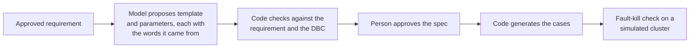

# Anvil

Test cases from approved requirements. The model never writes a test directly: it proposes a template and its parameters, code checks the proposal, a person approves it, and code generates the cases.



## Templates

| Template | For requirements like |
|---|---|
| threshold | "When the fuel level is below 10 percent, the low-fuel telltale shall be lit." |
| event response | "When BrakeWarn = 1, the cluster shall show the red brake telltale." |
| timeout | "If the Fuel message is missing for 500 ms, the cluster shall ..." |
| periodic transmission | "The cluster shall send ClusterStatus every 100 ms." |
| tracking | "The displayed speed shall not be less than the vehicle speed." |
| not automatable | Anything needing a person: a manual test idea is recorded |

Generated cases cover boundaries, ranges, timing and negative cases. Each is tied to the requirement clause it rests on and lists any value it had to assume.

## Fault-kill score

Every spec's cases run against a simulated correct cluster and against 24 injected fault types: threshold off by one step, inverted, stuck on or off, late, wrong value, timeout early or never, transmission stops, tracking frozen or out of band. The score reports the faults no case catches and the cases that catch nothing.

It scores the tests against a simulated cluster and a fixed fault list, not against a real cluster.

## Formal set check

Each approved spec is written as a formal statement, for example "When FuelLevel < 10, TT_LowFuel shall be 1 within 300 ms", and the set is checked by code for:

- conflicting responses to overlapping conditions or the same trigger
- different timeouts for the same message
- impossible tracking bands
- cluster outputs no spec checks

On the ICX-100 run it found that REQ-PWR-003's spec had dropped "after the goodbye screen" and so contradicted REQ-PWR-002.

## Exports

JSON, Excel, a linted pytest module, a Robot Framework suite, a CANoe CAPL test module and a flat step table (CSV). None of these are run on hardware.

## Commands

```powershell
.\.venv\Scripts\zyn anvil start <sift run>
.\.venv\Scripts\zyn anvil generate <run> --as NAME
.\.venv\Scripts\zyn anvil score <run>
.\.venv\Scripts\zyn anvil formal <run>
.\.venv\Scripts\zyn anvil export <run> --as NAME
```

`forge` still works as the old command name.

Code: [harness/anvil/](../../harness/anvil/)
