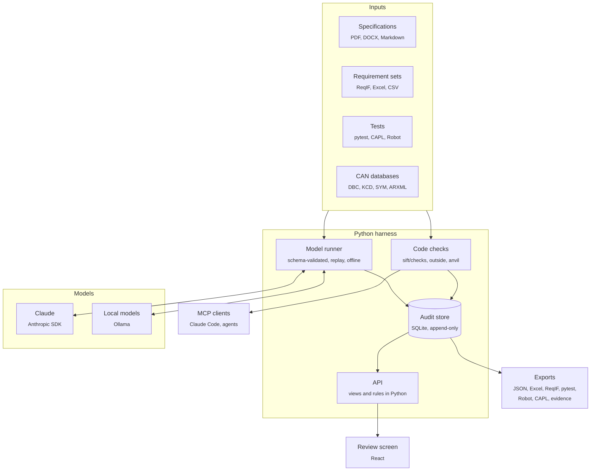

# Architecture

## Parts

| Part | Where | Role |
|---|---|---|
| Model runner | [harness/models/](../../harness/models/) | Calls Claude or Ollama through two thin adapters, validates every reply against a schema, retries with the errors, replays stored answers, refuses cloud calls in offline mode |
| Prompts | [harness/prompts/](../../harness/prompts/) | Versioned files. A released prompt is never edited; a change is a new `_v2` |
| Audit store | [harness/audit/store.py](../../harness/audit/store.py) | Append-only SQLite. Items are versioned; decisions are events; only a named person can approve |
| Code checks | [harness/sift/checks.py](../../harness/sift/checks.py), [harness/outside.py](../../harness/outside.py), [harness/anvil/](../../harness/anvil/) | Deterministic checks for every tool |
| API | [harness/api/](../../harness/api/) | Builds each screen from the audit store and enforces the rules again. Views are read-only by construction |
| Review screen | [web/](../../web/) | React app on the Zyn design system. The screen shows rules; it never decides them |
| MCP server | [harness/mcp_server.py](../../harness/mcp_server.py) | Zyn's code checks as tools for any MCP client. No model calls, nothing written |
| Benchmarks | [harness/pack.py](../../harness/pack.py), [evals/](../../evals/) | The pack, public evaluations and showcase benchmarks |

## Rules live in Python

Checks, blocked approvals and reasons are computed in `harness/api/views.py` and enforced again in `harness/api/server.py`. The screen only displays them, so a rule cannot be bypassed from the browser.

## A run, end to end

1. A run starts and gets an ID such as `20261113-165443-9c129b`.
2. Inputs are ingested; their sha256 is recorded.
3. Model calls go through the runner. Each call's prompt, input, response, model served, tokens and latency are logged.
4. Code checks write findings as items.
5. People decide items in the review screen. Each decision is an event with the person's name and reason.
6. Exports and the evidence report are written next to the run, with hashes logged.
