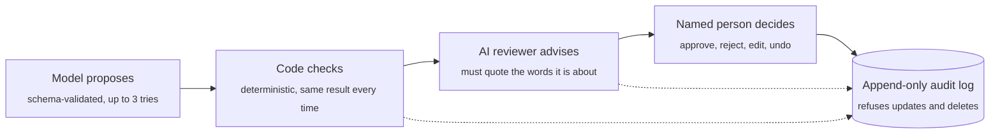

# How Zyn decides

Every item in Zyn, whether a requirement, a finding, a test spec or a changed sentence, passes through the same four steps. Each step is recorded.

## The four steps

**1. A model proposes.** Every reply must match a schema. An invalid reply goes back to the model with the errors, up to three times, then the call is recorded as failed. Free text is never accepted. Checker tools skip this step: they read work another tool produced.

**2. Code checks.** Deterministic checks run on every item: is the quote really in the source, did a value appear that the source never gives, did "should" become "shall", is the signal in the CAN database, is the value inside its range. A check either fires on evidence or stays silent. When there is nothing to check, Zyn says "skipped", never "passed". See the [Checks reference](Checks-reference.md).

**3. An AI reviewer advises.** A second model pass reviews each item. Every finding must quote words that code then confirms are in the item. The reviewer asks the author a question rather than rewriting. Its verdict is shown as advice. The audit store refuses an approval from any actor that is not a named person.

**4. A named person decides.** Approve, reject or edit, one key or one click. Undo adds a "reopened" record; nothing is erased. Approving over an objection requires a reason. Decisions on unchanged text carry over to later runs with one click.

## What the screen shows instead of confidence

Zyn never shows a model's confidence score. Cards show concrete support states:

- quote located in the source
- modal verb kept
- values from the source only
- vague words flagged
- open placeholders (`<TBD: ...>`) with a question for the spec author
- the AI reviewer's verdict, labelled as advice
- the decision record: "People confirmed 3 of 14 earlier findings of this kind from the AI reviewer (21%)", or "too few to judge" under five

## Six verdicts

Each item in the evidence report gets one verdict, so a model or infrastructure problem never looks like a finding, and nothing reads as right unless a named person said so:

| Verdict | Meaning |
|---|---|
| accepted | A named person approved it, dismissed its findings or marked no action |
| no findings | The checks that ran found nothing and no person has decided. This does not mean the item is right: code checks miss, for example, a signal name swapped for another valid one |
| fail | A real problem, confirmed by a person |
| warn | Needs a person: undecided, or approved over a failed check |
| skipped | Not checked, with the reason (not automatable, nothing checkable) |
| broken | Could not be checked: the model call for it failed |

## The audit log

SQLite on one computer, PostgreSQL for a team. Either way it is append-only: the database itself refuses updates and deletes, and in team mode the server's own database user can only read and add. Edits create new versions. Every prompt, input and response is kept, so any answer can be replayed. The evidence export writes the log as a hash chain that `zyn evidence verify` checks.

## Four eyes

In team mode a person may not approve, reject or confirm an item they created or edited, or a finding on a run they started. The rule is a setting per project, on by default, computed and enforced in Python. The screen shows the blocked action with the reason, and each decision records the setting that applied. Access tokens and service accounts can never decide.
